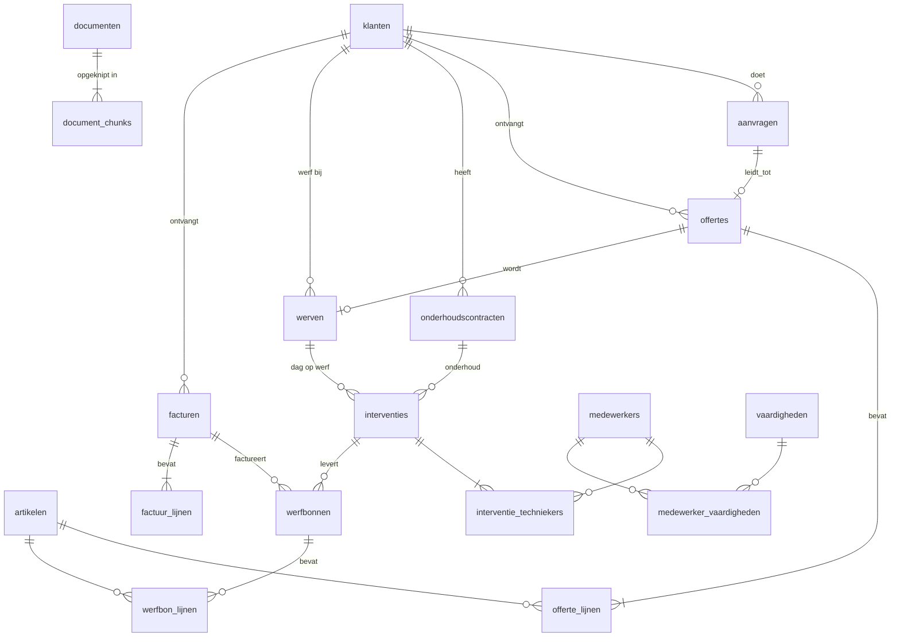

# Verbeke Installatietechniek — gedeelde database

Fictieve maar realistische database van een Oost-Vlaams installatiebedrijf (warmtepompen, ventilatie, sanitair).
Ze is het fundament onder een reeks AI- en automatisatieprojecten die elk één pijnpunt van het bedrijf oplossen.

> **Alles is verzonnen.** Bedrijf, medewerkers, klanten en adressen bestaan niet.
> E-mailadressen gebruiken het gereserveerde domein `example.com`, zodat een automatisatie nooit echte mensen mailt.
> Telefoonnummers zijn willekeurig: stuur er nooit echte sms'en of WhatsApp-berichten naar.

## Het bedrijf

| | |
|---|---|
| Vestiging | Lede, Oost-Vlaanderen — familiebedrijf, tweede generatie |
| Team | 38 medewerkers: 26 techniekers, 3 werfleiders, 1 calculator, administratie, planning en klantendienst |
| Activiteit | Plaatsing en onderhoud van warmtepompen, ventilatie en sanitair; 1.800 onderhoudscontracten |
| Tools vandaag | Excel-offertes, papieren werfbonnen, whiteboard + Outlook-planning, een WhatsApp-groep per werf |

## De pijnpunten, meetbaar in de data

| Pijnpunt | Hoe het in de data zit | Controle |
|---|---|---|
| Facturatie loopt 3 tot 6 weken achter | Werfbonnen staan `op_papier` of `ingegeven`; gemiddeld ±33 dagen van bon tot factuur | `select * from v_facturatie_achterstand;` |
| Offerte duurt 3 tot 4 weken | Gemiddeld ±26 dagen van aanvraag tot verstuurde offerte | `select * from v_offerte_opvolging;` |
| 40% van de offertes wordt nooit opgevolgd | `laatste_opvolging_op is null` bij ±40% van de verstuurde offertes | idem |
| Planning zit in één hoofd | ±275 onderhoudsbeurten `te_plannen`, waarvan een deel achterstallig | `select count(*) from interventies where status = 'te_plannen';` |
| Klantendienst: "wanneer komt de technieker?" | Geplande interventies met tijdsblok en toegewezen technieker | `interventies` + `interventie_techniekers` |
| Kennis zit bij ervaren techniekers | Werkinstructies, veiligheidsfiches en FAQ's in `documenten`, klaar voor RAG | `document_chunks.embedding` |

## Datamodel



**De flow:** aanvraag → plaatsbezoek → offerte → werf → interventies → werfbonnen → factuur.
Onderhoud loopt apart: contract → interventie → werfbon → factuur.

## Projecten die op deze database bouwen

| # | Project | Tabellen |
|---|---|---|
| 1 | Werfbon-app met automatische facturatie | `werfbonnen`, `werfbon_lijnen`, `facturen` |
| 2 | Offerte-assistent met modelvergelijking | `aanvragen`, `offertes`, `offerte_lijnen`, `artikelen` |
| 3 | Intake en automatische opvolging (n8n) | `aanvragen`, `offertes` |
| 4 | Klantenbot (Mistral, data in Europa) | `interventies`, `onderhoudscontracten`, `documenten` |
| 5 | Planning-assistent (Claude + MCP) | `interventies`, `medewerker_vaardigheden`, `onderhoudscontracten` |
| 6 | Kennisagent voor techniekers (Microsoft Foundry) | `documenten`, `document_chunks` |
| 7 | Onderhoudsflow (Make) | `onderhoudscontracten`, `interventies` |

## Installeren in Supabase

1. Maak een nieuw Supabase-project (Free plan volstaat: de seed is ±1 MB).
2. Open de **SQL Editor** en voer `supabase/migrations/0001_schema.sql` uit.
3. Voer daarna `supabase/seed.sql` uit.

Of met de Supabase CLI:

```bash
supabase link --project-ref <jouw-project-ref>
supabase db push            # migraties
psql "$DATABASE_URL" -f supabase/seed.sql
```

**Beveiliging:** Row Level Security staat op elke tabel aan, zonder policies. Enkel de service role kan dus lezen
en schrijven. Elk project voegt zijn eigen policies toe (bijvoorbeeld: een technieker ziet enkel zijn eigen werfbonnen).

**Intake (project 3):** n8n logt in als de rol `n8n_intake`. Die rol mag enkel `intake_aanvraag(...)` uitvoeren
(migratie 0005) en kan geen tabellen lezen. Het wachtwoord zet je zelf in de SQL-editor:
`alter role n8n_intake password '...'`.

## Data opnieuw genereren

De data is reproduceerbaar (vaste random seed) met peildatum 5 november 2026.

```bash
python3 scripts/generate_seed.py > supabase/seed.sql
```

Pas `VANDAAG` bovenaan het script aan om de data naar een andere datum te verschuiven.

## Inhoud in cijfers

| Tabel | Rijen |
|---|---|
| medewerkers | 38 |
| klanten | 1.700 |
| onderhoudscontracten | 1.800 |
| aanvragen | 420 |
| offertes | 285 |
| werven | 100 |
| interventies | ±1.300 |
| werfbonnen | ±850 |
| facturen | ±380 |
| documenten | 10 |
